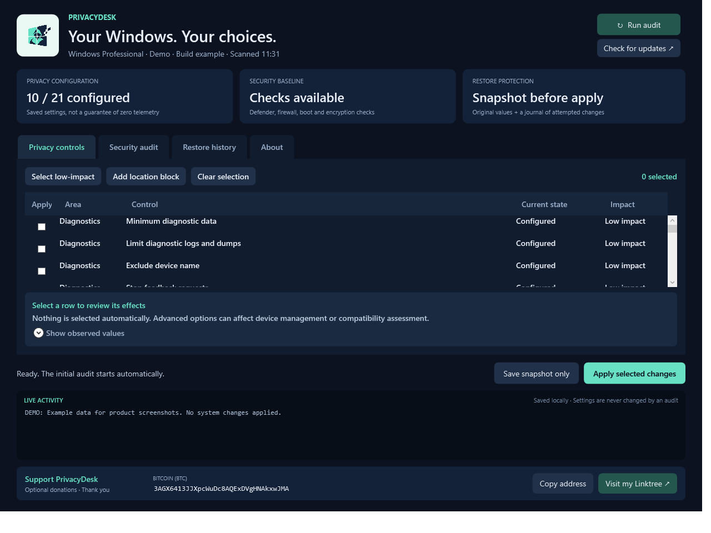
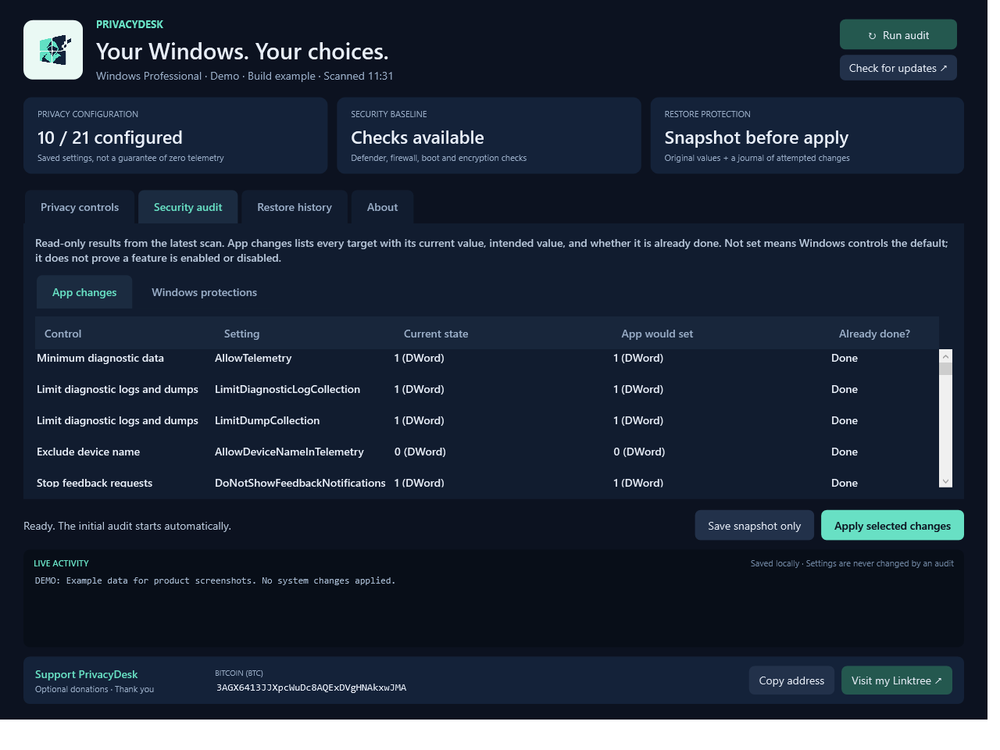
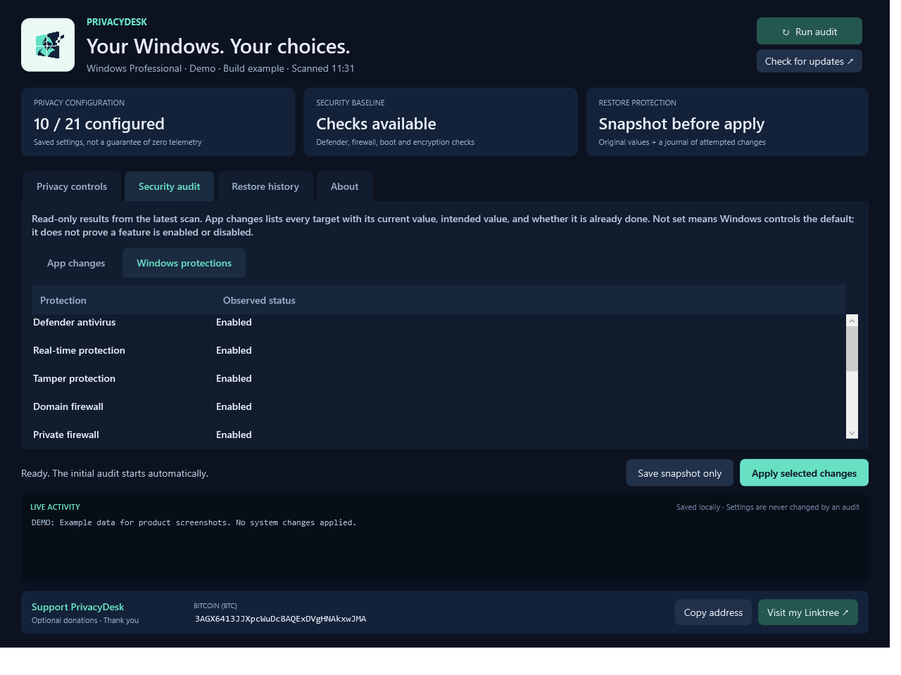
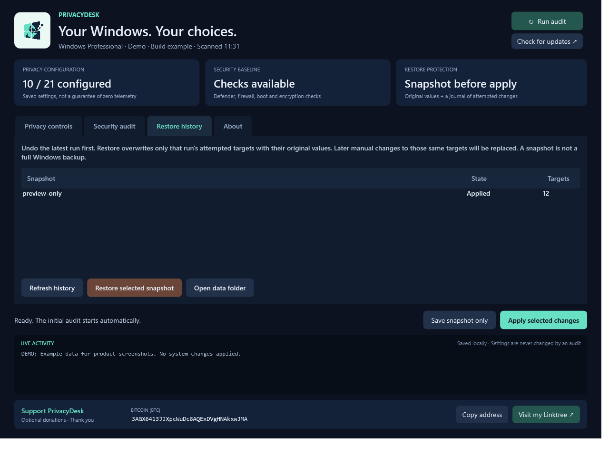

# PrivacyDesk 1.1

## Your computer should work for you

We believe Windows goes too far with telemetry, tracking, and personalized recommendations. People should have a clear say in what their operating system collects and shares. When those controls are scattered across settings, policies, services, and scheduled tasks, it can be hard to tell what is happening on your own computer.

**PrivacyDesk helps you take that control back.** It brings Windows privacy controls into one app, shows how your PC is configured today, and lets you choose what to turn off.

[Download the Windows executable](dist/PrivacyDesk.exe) · [Download the portable ZIP](dist/PrivacyDesk-1.1-win-x64.zip)

## What it does for you

- **See where you stand.** Start with a read-only scan of Windows privacy settings and important protections such as Defender and the firewall. See which changes are already done and which are not.
- **Choose what you share.** Reduce optional diagnostics, advertising personalization, activity uploads, and other tracking-related features. You can also block Windows location access and Find my device.
- **Understand each choice.** Every control explains its effects. Low-impact options are grouped together; more aggressive service and task changes are optional.
- **Stay in control of changes.** Review your selection, watch the live activity log, and use the automatic snapshot to undo the settings changed by a run.

The basic flow is **scan → choose → apply → review**, with restore available if you change your mind. You do not need to edit the registry or understand PowerShell to use the app. PrivacyDesk runs its audit and settings operations locally, without an account or analytics, and leaves Windows security protections intact.

This is a tool for reducing Windows data collection, not a promise that every kind of tracking disappears. Windows Pro/Home still retain required diagnostic data at their supported minimum, apps and browsers have their own privacy controls, and some restrictions affect features you may use. The app explains those tradeoffs before you apply them.

## Product screenshots

These screenshots use **example data**, not a published audit of a real user's PC. Your results will depend on your Windows edition and current settings.

### Choose your privacy settings

Review the current configuration, select individual controls or the low-impact preset, and read what each option changes. The activity log and restore actions stay close at hand.

### See exactly what is already done

The app-changes audit shows each setting's current value, the value PrivacyDesk would apply, and whether the setting is already done. This makes it easy to see what would actually change.

### Check Windows protections

The Windows protections view reports the security checks separately, including antivirus, real-time protection, firewall profiles, Secure Boot, and drive encryption where available.

### Keep a way back

Restore history records snapshots from app runs. Choose an applied snapshot to restore the original values for that run's changes. The entry shown here is a demonstration.

## Start

Open `dist\PrivacyDesk.exe`. Windows asks for administrator permission. The initial scan is read-only; no controls are selected automatically. The executable embeds its UI and PowerShell engine, so you can copy the EXE to another folder without copying the source.

Built for Windows 11 x64 using the Windows-provided .NET Framework/WPF and Windows PowerShell 5.1. No installer, package download, account, analytics or background service. Audit and settings operations run locally. The Linktree and Check for updates buttons open the specified websites only when clicked. The executable is unsigned; its publisher has not been verified by a signing certificate. Use an administrator account belonging to the Windows user whose per-user settings you want to manage.

## Workflow

1. **Audit:** Reads 21 privacy-control groups (37 individual setting targets). Under **Security audit > App changes**, every target shows its current state, the value the app would set, and Done / Not done / Unknown / Unsupported edition / Not installed. Windows protections checks Defender, real-time and tamper protection, each firewall profile, the Windows Update service, Secure Boot and system-drive encryption. Unknown/unavailable checks are identified. An idle update service does not imply Windows Update is broken. No patch-compliance or vulnerability scan is performed.
2. **Choose:** Check individual controls. `Select low-impact` selects all available low-impact options, including already-configured ones. The engine skips values that already match. `Add location block` selects location and Find my device restrictions. Advanced service and task controls remain optional. Select any row to read its effects and observed values.
3. **Snapshot:** `Save snapshot only` records the selected targets without changing them. Every Apply also creates its own fresh snapshot automatically before the first write. Preview snapshots are retained as records, but have nothing to undo.
4. **Apply:** Review the selected controls in the confirmation dialog. The live log shows progress and read-back verification. The app stops applying on the first error; the partial run stays in restore history.
5. **Restore:** Choose an applied or incomplete run from Restore history. Undo newer overlapping runs first. Restoration checks the machine and user, restores only attempted targets, verifies results, and retains the snapshot. An incomplete restoration can be retried. Later manual changes to those same targets will be overwritten with the saved originals.
6. **Rescan/restart:** The app automatically reruns its audit after apply or restore. You can also run an audit manually at any time. Restart when convenient to let affected Windows components reload policies. The app does not reboot automatically.

The **Check for updates** button opens [the GitHub repository](https://github.com/Sl0thzy/privacydesk); it does not download or install software automatically.

## What is included

- Minimum diagnostic-data policy appropriate to the Windows edition; diagnostic logs/dumps; device-name exclusion; feedback requests.
- Advertising ID; correctly user-scoped tailored-experience policy; typing/inking collection; launch tracking; website language-list sharing.
- Activity publication/uploads and optional activity-feed disabling.
- Windows location restrictions, app location consent and Find my device.
- Optional CEIP and application-inventory policies, DiagTrack, dmwappushservice, compatibility tasks, CEIP tasks and feedback tasks.
- Consumer-experience policy is gated to editions that support it. Missing services/tasks are reported and skipped, not treated as successful changes.

Defender, firewall, SmartScreen and Windows Update are not disabled by any control. Stopping services never force-stops dependent services. `dmwappushservice` is clearly marked as potentially breaking Intune/MDM. The app does not guarantee zero telemetry: Pro/Home retain required diagnostics at the supported minimum, apps/browsers have independent settings, and websites can infer approximate location from IP addresses.

## Snapshots and logs

Stored under `%LOCALAPPDATA%\PrivacyDesk` for the account running the app:

- `Snapshots\*.clixml`: versioned, uniquely named snapshots with raw registry values and types, original existence, service startup/running and delayed-start state, and task enabled state.
- `Snapshots\*.clixml.previous`: prior journal revision retained by atomic replacement.
- `Logs\*.log`: per-session live activity logs.
- `Runtime\`: the embedded engine is extracted into a unique session directory and removed on normal exit. After a crash, leftover session files are inert.

The complete selected state is captured before mutations. Each target is journaled before its write, allowing recovery from failures and interrupted runs. Registry writes use .NET value-level operations; existing registry keys are not recreated or deleted. Restoring an originally absent value removes only that value and leaves empty keys in place. This is a settings snapshot, not a disk image or Windows System Restore point. Keep the snapshot folder for rollback; snapshots may contain private configuration values.

The app does not import old backups from earlier standalone scripts. Their original restoration scripts and backup files remain separate. New snapshots represent the PC's state when this app is used, including any earlier privacy changes already applied.

## Build and source

Run `build.ps1` from PowerShell. It uses the compiler bundled with .NET Framework, with no NuGet packages or downloads.

- `src\Main.xaml`: WPF interface and theme.
- `assets\`: logo PNG, multi-resolution Windows icon, and generation provenance.
- `make-icon.ps1`: reproducible PNG-to-ICO packaging.
- `test.ps1`: isolated engine tests and read-only UI/audit regression checks.
- `src\App.cs`: asynchronous worker, event/log handling and UI.
- `src\Engine.ps1`: catalog, audit, capture/apply/restore and isolated mock tests.
- `src\app.manifest`: administrator execution level and DPI awareness.
- `dist\PrivacyDesk.exe`: self-contained application assets; Windows runtimes are required.
- `tests\PrivacyDesk.Preview.exe`: unprivileged QA harness, not the distributed app.

## Verification

Engine tests simulate changes in an in-memory store and create only test snapshot files. They cover capture-only behavior, snapshot-before-write, exact registry restoration, originally absent values, delayed-start services, already-disabled tasks, partial-apply recovery, cross-machine rejection, snapshot serialization, concurrent-state detection, restore retry and out-of-catalog target rejection.

UI smoke tests ingest the actual read-only audit, verify control/checkbox/history data handling, selection of already-configured low-impact controls, every target current/desired/status field, and embedded logo/icon loading, and render the privacy, security and restore tabs for visual inspection. The packaged executable has an additional `--smoke-live <output-folder>` QA mode that performs its normal read-only startup audit, writes a screenshot/report, then exits. It never selects or applies controls.

No real apply/restore was run against the development PC while building this app. Failure/recovery testing uses mocks; a disposable Windows VM is the appropriate place for broader destructive/interruption and Windows-version testing before wider distribution.
